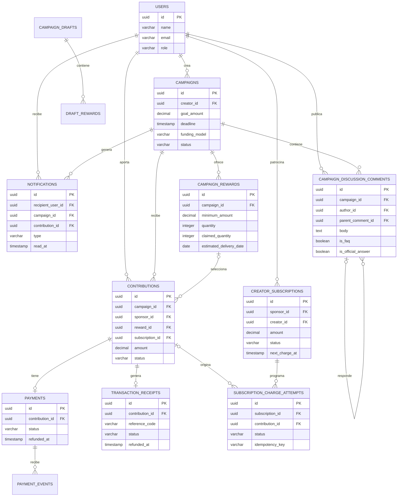

# Modelo mínimo de datos - Plataforma Crowdfunding

Este documento define el mínimo que deben almacenar los datos para las historias de usuario 2.1.2, 2.1.3, 3.1.2, 3.2.2, 4.1.1 y 4.1.2. Se separa por historia, pero el diseño reutiliza las entidades existentes del backend y las estructuras ya consumidas por el frontend.

## Convenciones y entidades base existentes

Los siguientes datos ya existen en el proyecto y deben reutilizarse; no deben duplicarse:

| Entidad existente | Campos relevantes | Uso compartido |
|---|---|---|
| `users` | `id`, `name`, `email`, `role`, `verification_status`, `status` | Creador y patrocinador |
| `campaigns` | `id`, `creator_id`, `title`, `description`, `goal_amount`, `deadline`, `currency`, `status`, `published_at` | Campaña, cierre y progresos |
| `campaign_drafts` | datos guardables del borrador y `completion_percentage` | Configuración previa de campaña |
| `campaign_rewards` | `title`, `description`, `minimum_amount`, `quantity`, `claimed_quantity` | Nivel de recompensa publicado |
| `draft_rewards` | `title`, `description`, `minimum_amount`, `sort_order` | Nivel de recompensa en borrador |
| `contributions` | `campaign_id`, `sponsor_id`, `reward_id`, `amount`, `currency`, `status`, `confirmed_at`, `idempotency_key` | Aporte principal e historial |
| `payments` | `contribution_id`, `provider`, `provider_payment_id`, `amount`, `platform_fee`, `status`, `failure_code`, `failure_message` | Resultado del cobro |
| `payment_events` | `payment_id`, `provider_event_id`, `event_type`, `payload_hash`, `processed_at` | Idempotencia y trazabilidad del proveedor |
| `transaction_receipts` | `contribution_id`, `reference_code`, `status`, `issued_at`, `refunded_at` | Comprobante visible al patrocinador |
| `notifications` | `recipient_user_id`, `campaign_id`, `campaign_update_id`, `type`, `title`, `body`, `read_at`, `created_at` | Bandeja y contador de no leídas |

El identificador para todas las entidades nuevas debe ser `UUID`. Los montos deben permanecer como `DECIMAL(19,2)` y las fechas como `TIMESTAMP WITH TIME ZONE`.

## HU 2.1.2 - Configuración del modelo de recaudación

### Datos mínimos

Agregar a `campaigns`:

| Campo nuevo | Tipo | Regla |
|---|---|---|
| `funding_model` | `VARCHAR(20) NOT NULL DEFAULT 'FIXED'` | Enumeración `FIXED` o `FLEXIBLE` |

También agregar el campo equivalente a `campaign_drafts` para conservar la elección mientras la campaña todavía es borrador:

| Campo nuevo | Tipo | Regla |
|---|---|---|
| `funding_model` | `VARCHAR(20) DEFAULT 'FIXED'` | Enumeración `FIXED` o `FLEXIBLE` |

Extender `CampaignStatus` si fuera necesario para representar el cierre. Ya existen `SUCCESSFUL` y `FAILED`; pueden representar respectivamente "meta alcanzada" y "meta no alcanzada". Agregar a `CampaignStatus` únicamente si no existe en la migración/servicio:

| Estado | Uso |
|---|---|
| `SUCCESSFUL` | Campaña fija que alcanzó la meta o campaña flexible con aportes válidos al vencer |
| `FAILED` | Campaña fija que venció sin alcanzar la meta |

Extender los estados de `contributions` y `transaction_receipts`:

| Entidad | Estados mínimos |
|---|---|
| `contributions.status` | `PENDING`, `HELD`, `CONFIRMED`, `FAILED`, `REFUNDED` |
| `transaction_receipts.status` | `HELD`, `SUCCESSFUL`, `REFUNDED`, `FAILED` |

En esta HU se pueden considerar los estados finales así:

- `HELD`: fondos retenidos mientras la campaña sigue activa.
- `CONFIRMED` o `SUCCESSFUL`: aportes aprobados/consolidados después de un cierre exitoso.
- `REFUNDED`: aporte devuelto después de un cierre fallido.

Para evitar cambiar el estado de la contribución y el comprobante por separado, la operación de cierre debe actualizar ambos dentro de una transacción de base de datos.

### Entidades reutilizadas

- `campaigns` para guardar `funding_model`, meta, fecha límite y estado final.
- `contributions` para ubicar los aportes asociados a la campaña.
- `payments` para confirmar que el cobro fue exitoso antes de pasar el aporte a `HELD`.
- `transaction_receipts` para reflejar `HELD`, `SUCCESSFUL` o `REFUNDED`.
- `users` para identificar al creador propietario de la campaña.

### Resultado mínimo de persistencia

El cierre batch debe conservar una decisión determinista:

1. Fija y porcentaje mayor o igual a 100: cerrar como `SUCCESSFUL` y pasar aportes exitosos a aprobado/consolidado.
2. Fija y porcentaje menor a 100: cerrar como `FAILED` y pasar aportes retenidos a reembolsados.
3. Flexible y monto recaudado mayor que cero al vencer: cerrar como `SUCCESSFUL` y pasar aportes exitosos a aprobado/consolidado.
4. Flexible sin aportes confirmados: puede cerrar como `FAILED`; no existen fondos que consolidar ni reembolsar.

---

## HU 2.1.3 - Niveles de patrocinio

### Entidades reutilizadas

- `campaign_rewards` para niveles ya publicados.
- `draft_rewards` para niveles guardados en borrador.
- `campaigns` y `campaign_drafts` como dueños de los niveles.
- `contributions.reward_id` para conocer qué recompensa fue elegida por un patrocinador.

### Campos mínimos a completar

`campaign_rewards` ya contiene título, descripción, monto mínimo y cupos. Falta:

| Campo nuevo | Tipo | Regla |
|---|---|---|
| `estimated_delivery_date` | `DATE NULL` | Fecha estimada de entrega |

También debe agregarse a `draft_rewards` para que el borrador conserve el dato:

| Campo nuevo | Tipo | Regla |
|---|---|---|
| `estimated_delivery_date` | `DATE NULL` | Se propone obligatorio al publicar la campaña |

Campos mínimos que ya existen y deben validarse:

- `title`: obligatorio, máximo 120 caracteres.
- `description`: obligatoria según el formulario; máximo sugerido 2.000 caracteres.
- `minimum_amount`: obligatorio y mayor que 0.
- `quantity`: entero positivo si es limitado; `NULL` puede significar cupos ilimitados.
- `claimed_quantity`: entero no negativo, inicia en 0.
- `campaign_id` / `draft_id`: relación obligatoria.

### Modelo derivado

No es necesario crear una entidad adicional de disponibilidad. Puede calcularse como:

```text
disponible = quantity IS NULL OR claimed_quantity < quantity
cupos_restantes = quantity - claimed_quantity
estado_visual = AGOTADO cuando quantity IS NOT NULL AND claimed_quantity >= quantity
```

Al confirmar un aporte con recompensa, el backend debe validar el cupo dentro de una operación transaccional y aumentar `claimed_quantity` una sola vez. Reutilizar `contributions.idempotency_key` evita contar dos veces el mismo aporte.

### Frontend

El frontend debe enviar y recibir `estimatedDeliveryDate` además de los campos ya definidos en `Reward`. La pantalla debe deshabilitar el nivel cuando `quantity !== null && claimedQuantity >= quantity` y mostrar la etiqueta `Agotado`.

---

## HU 3.1.2 - Suscripción o aportes recurrentes

### Entidades nuevas mínimas

Crear `creator_subscriptions`:

| Campo | Tipo | Clave / regla |
|---|---|---|
| `id` | `UUID` | PK |
| `sponsor_id` | `UUID` | FK a `users(id)`, NOT NULL |
| `creator_id` | `UUID` | FK a `users(id)`, NOT NULL |
| `payment_method_ref` | `VARCHAR(160)` | Referencia/token seguro del método de pago, no almacenar tarjeta |
| `amount` | `DECIMAL(19,2)` | NOT NULL y mayor que 0 |
| `currency` | `VARCHAR(3)` | NOT NULL |
| `status` | `VARCHAR(20)` | `ACTIVE`, `CANCELLED`, `FAILED` |
| `next_charge_at` | `TIMESTAMP WITH TIME ZONE` | Próximo cobro |
| `last_charge_at` | `TIMESTAMP WITH TIME ZONE NULL` | Último cobro |
| `cancelled_at` | `TIMESTAMP WITH TIME ZONE NULL` | Fecha de cancelación |
| `created_at` | `TIMESTAMP WITH TIME ZONE` | NOT NULL |
| `updated_at` | `TIMESTAMP WITH TIME ZONE` | NOT NULL |

Relación única lógica: un patrocinador puede tener varias suscripciones a distintos creadores, pero conviene mantener una única suscripción activa por combinación `sponsor_id + creator_id` mediante índice parcial único.

Crear `subscription_charge_attempts` para auditar cada renovación:

| Campo | Tipo | Clave / regla |
|---|---|---|
| `id` | `UUID` | PK |
| `subscription_id` | `UUID` | FK a `creator_subscriptions(id)`, NOT NULL |
| `scheduled_at` | `TIMESTAMP WITH TIME ZONE` | Fecha programada |
| `processed_at` | `TIMESTAMP WITH TIME ZONE` | Fecha de ejecución |
| `status` | `VARCHAR(20)` | `PENDING`, `SUCCEEDED`, `FAILED` |
| `contribution_id` | `UUID NULL` | FK a `contributions(id)` |
| `payment_id` | `UUID NULL` | FK a `payments(id)` |
| `failure_code` | `VARCHAR(80) NULL` | Motivo de fallo |
| `failure_message` | `VARCHAR(500) NULL` | Información segura |
| `idempotency_key` | `VARCHAR(128)` | Único por intento |

### Entidades reutilizadas

- `users.sponsor_id` y `users.creator_id` para los participantes.
- `payments` y `payment_events` para ejecutar y confirmar cada cobro.
- `contributions` para registrar la renovación como aporte con historial. En este caso conviene añadir `subscription_id` y `subscription_charge_attempt_id` a `contributions` para distinguir aportes recurrentes de aportes normales.
- `notifications` para avisar al creador después de una renovación exitosa.

### Entidad derivada opcional

No es necesario persistir el método de pago completo; `payment_method_ref` debe ser el identificador/token emitido por el proveedor. El estado real o fondos disponibles se consultan al proveedor o se reflejan mediante un fallo registrado en `subscription_charge_attempts`.

### Estados y reglas

- Crear suscripción activa solo si el primer cobro tiene un resultado exitoso.
- El cobro periódico actualiza `next_charge_at` solo después de procesar el intento.
- Cancelar cambia el estado a `CANCELLED`, establece `cancelled_at` y impide nuevos intentos.
- Un método inválido o sin fondos debe crear un intento fallido y mantener la suscripción fuera de `ACTIVE`.

---

## HU 3.2.2 - Gestión de reembolsos de campañas fallidas

### Entidades reutilizadas

- `contributions.status`: estado operativo del aporte.
- `transaction_receipts.status`: estado visible en el comprobante.
- `payments.status`: estado real del cobro.
- `campaigns.funding_model`, `campaigns.status`, `campaigns.goal_amount` y `campaigns.deadline`.
- `users` para patrocinador y creador.
- `notifications` para avisar al patrocinador.

### Estados mínimos requeridos

Los estados siguientes deben ser consistentes:

| Operación | Contribution | Payment | Receipt |
|---|---|---|---|
| Cobro confirmado en campaña fija activa | `HELD` | `SUCCEEDED` | `HELD` |
| Campaña fija fallida | `REFUNDED` | `REFUNDED` | `REFUNDED` |
| Reintento fallido | `FAILED` | `FAILED` | `FAILED` |

No es necesario crear un nuevo comprobante por reembolso. Se reutiliza el `transaction_receipts` único asociado al `contribution_id` y se actualizan `status` y `refunded_at`.

### Campos mínimos adicionales para trazabilidad

Aunque el diseño mínimo puede depender de los campos existentes, se recomienda agregar:

| Entidad/campo | Tipo | Uso |
|---|---|---|
| `payments.refunded_at` | `TIMESTAMP WITH TIME ZONE NULL` | Momento del reembolso |
| `contributions.closed_at` | `TIMESTAMP WITH TIME ZONE NULL` | Momento del cierre del aporte |
| `notifications.contribution_id` | `UUID NULL` | Vincular notificación de reembolso o aporte |

### Operación batch

Para una campaña fija que falló:

1. Seleccionar solo contribuciones con `status = 'HELD'` y campaña vencida.
2. Cambiar `contributions.status` a `REFUNDED`.
3. Cambiar el `transaction_receipts.status` asociado a `REFUNDED` y llenar `refunded_at`.
4. Cambiar el pago correspondiente a `REFUNDED` y llenar `refunded_at`.
5. Crear una notificación interna por patrocinador, evitando duplicados con una clave o condición única.

La actualización masiva debe ser idempotente: repetir el cierre no debe generar nuevos reembolsos, comprobantes ni notificaciones.

---

## HU 4.1.1 - Comentarios y preguntas frecuentes

### Entidad nueva mínima

Crear `campaign_discussion_comments`:

| Campo | Tipo | Clave / regla |
|---|---|---|
| `id` | `UUID` | PK |
| `campaign_id` | `UUID` | FK a `campaigns(id)`, NOT NULL |
| `author_id` | `UUID` | FK a `users(id)`, NOT NULL |
| `parent_comment_id` | `UUID NULL` | Auto FK para respuestas o hilos |
| `body` | `TEXT` | NOT NULL, 1 a 1.000 caracteres |
| `is_official_answer` | `BOOLEAN` | NOT NULL, inicia en false |
| `is_faq` | `BOOLEAN` | NOT NULL, inicia en false |
| `created_at` | `TIMESTAMP WITH TIME ZONE` | NOT NULL |
| `updated_at` | `TIMESTAMP WITH TIME ZONE` | NOT NULL |

No es necesario duplicar la pregunta en otra tabla al convertirla a FAQ. La misma fila debe marcar `is_official_answer = true` y `is_faq = true`. La pestaña FAQ filtra por ambas banderas.

### Entidades reutilizadas

- `campaigns` para asociar el hilo.
- `users` para autor, patrocinador o creador.
- `notifications` puede usarse si se desea avisar una respuesta, aunque no es obligatorio en esta historia.

### Reglas mínimas

- `body` no puede ser vacío ni superar el máximo acordado.
- Solo el creador propietario de la campaña puede marcar una respuesta como FAQ.
- `parent_comment_id` permite respuestas en hilo sin crear una entidad aparte.
- Definir índices por `(campaign_id, created_at)` y `(campaign_id, is_faq, is_official_answer)`.

---

## HU 4.1.2 - Notificación de nuevos aportes al creador

### Entidad reutilizada

`notifications` ya contiene:

- `recipient_user_id`: creador que recibe el aviso.
- `campaign_id`: campaña del aporte.
- `type`, `title`, `body`: clasificación y texto.
- `read_at`: determina si está sin leer.
- `created_at`: ordena la bandeja.

### Campo mínimo adicional

Agregar a `notifications`:

| Campo nuevo | Tipo | Uso |
|---|---|---|
| `contribution_id` | `UUID NULL` | Relación directa con el aporte que originó la notificación |

También conviene que `contribution_id` tenga FK a `contributions(id)` y sea parte de una restricción única con `recipient_user_id` y `type` para evitar notificaciones duplicadas.

### Datos derivados del mensaje

La plataforma puede construir el mensaje con datos existentes:

- Creador: `campaigns.creator_id`.
- Nombre del patrocinador: `users.name` unido por `contributions.sponsor_id`.
- Anónimo: usar esta etiqueta si el patrocinador no comparte su nombre o el dato no está disponible.
- Monto: `contributions.amount`.
- Moneda: `contributions.currency`.

Texto mínimo:

```text
¡Nuevo aporte! [Nombre del patrocinador o Anónimo] ha aportado $[Monto] [Moneda]
```

El contador de no leídas se calcula como `COUNT(notifications WHERE recipient_user_id = creator_id AND read_at IS NULL)`. El frontend puede consultar periódicamente la API existente.

---

## Modelo relacional mínimo integrado



## Migraciones mínimas recomendadas

La implementación debería dividirse en al menos las siguientes migraciones:

1. Añadir `funding_model` a campañas y borradores.
2. Añadir estados retenido/aprobado/reembolsado y restricciones compatibles.
3. Añadir fecha estimada de entrega a recompensas y recompensas de borrador.
4. Crear `creator_subscriptions` y `subscription_charge_attempts`.
5. Añadir `subscription_id` y referencia de intento a las contribuciones.
6. Crear `campaign_discussion_comments`.
7. Añadir `contribution_id` a notificaciones y relaciones de trazabilidad.

## Regla transversal de consistencia

Toda operación que cierre una campaña, reembolse aportes, consolide fondos o genere una renovación debe ejecutarse dentro de una transacción y actualizar la información relacionada de forma atómica: campaña, contribución, pago/comprobante, suscripción o notificación según corresponda. Las claves de idempotencia y los índices únicos deben impedir duplicados ante reintentos del batch o del proveedor de pagos.
